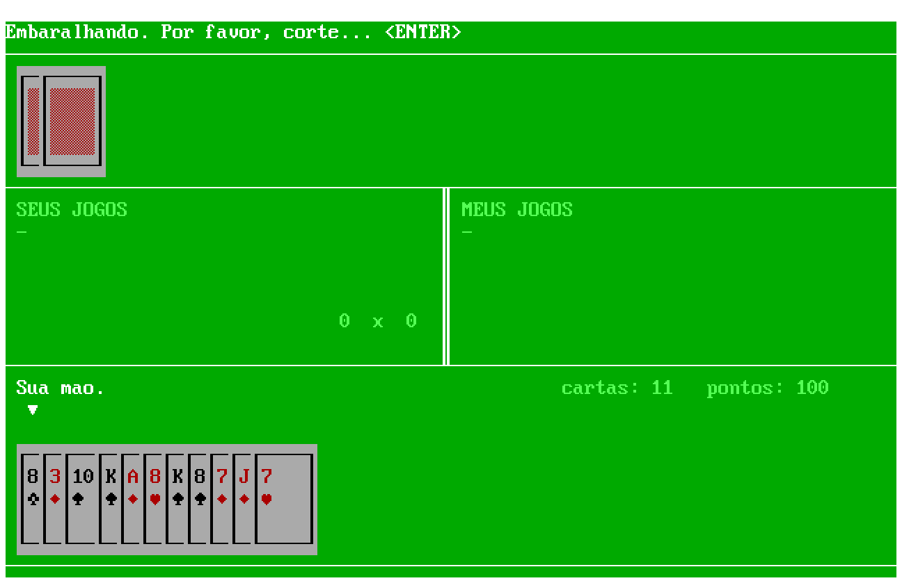

# Buraco — do MS-DOS ao Windows e Linux com SDL2

Reengenharia e porte nativo do clássico de cartas **Buraco** (`BURACO.EXE`),
originalmente distribuído para MS-DOS.

O projeto é dividido em duas frentes:

1. **Reengenharia reversa** do executável original — descompactação com
   *UNP 4.11*, análise em *Ghidra* e captura de runs em *DOSBox-X*
   (scripts em `tools/`; o workspace `work/` é mantido apenas localmente);
2. **Porte nativo** — reimplementação do jogo em **C++20 + SDL2**, sem
   emulação: regras, baralho, IA, máquina de turnos e apresentação foram
   reescritos, mantendo a mesma tela de texto 80×25 (glifos CP437 com a
   fonte VGA 8×16 extraída dos glifos do próprio jogo).

> Detalhes técnicos completos (endereços do descompilado, FPS/teclado fake
> BIOS, tabela da fonte, gravação/restauração) estão em
> [`port/README.md`](port/README.md).

## Build

```powershell
# build rápido (MinGW-w64 + CMake + SDL2 no work\toolchain)
.\port\build.ps1

# ou manualmente:
cmake -S port -B port\build -G "MinGW Makefiles" -DCMAKE_BUILD_TYPE=Release `
      -DSDL2_DIR=work\toolchain\sdl2\SDL2-2.32.10\x86_64-w64-mingw32\lib\cmake\SDL2
cmake --build port\build
Copy-Item work\toolchain\sdl2\SDL2-2.32.10\x86_64-w64-mingw32\bin\SDL2.dll port\build\
.\port\build\buraco.exe
```

Os scripts de build detalhados usam *MinGW-w64 GCC 16.2.0 (UCRT, POSIX, SEH)*,
*CMake 4.4.4* e *SDL2 2.32.10* (pacote `SDL2-devel-*-mingw.zip`). Fluxo com
`vcpkg` + gerador Visual Studio também funciona — veja `port/README.md`.

Em builds MinGW, o `POST_BUILD` copia para `port\build` as DLLs de runtime do
compilador (`libgcc_s_seh-1.dll`, `libstdc++-6.dll` e `libwinpthread-1.dll`),
além de `assets/`. A `SDL2.dll` continua vindo do SDK do SDL2. O zip da release
inclui todas elas e o `LICENSE`, então o jogo roda em PCs sem o MinGW
instalado.

### Linux

Requisitos: CMake 3.20+, compilador C++20 e SDL2 2.0.18+ (`libsdl2-dev` no
Debian/Ubuntu, `SDL2-devel` no Fedora, `sdl2` no Arch).

```bash
./port/build.sh
ctest --test-dir port/build --output-on-failure
./port/build/buraco
```

O `build.sh` usa Ninja quando disponível, copia `assets/` para o lado do
binário e aceita `--build-dir`, `--debug` e `--sdl-dir`. Para instalar no
layout FHS:

```bash
cmake --install port/build --prefix /usr/local
# /usr/local/bin/buraco
# /usr/local/share/buraco/assets/font8x16.bin
```

Com o binário instalado, o jogo procura a fonte em
`<prefixo>/share/buraco/assets` e grava os saves/config em
`~/.local/share/buraco/buraco/` (a pasta de instalação é somente leitura).
Rodando direto da árvore de build, tudo fica ao lado do executável, como no
Windows. `buraco --display-info` mostra os caminhos resolvidos.

### Pacotes Linux

```bash
./packaging/linux/pack_linux.sh              # build + dist/buraco-linux-x86_64.tar.gz
./packaging/linux/pack_linux.sh --deb        # tarball + dist/buraco_1.0.0_amd64.deb
./packaging/linux/appimage.sh                # build + dist/buraco-x86_64.AppImage
```

Os dois scripts aceitam `--build-dir DIR`, `--out DIR` e `--skip-build`; o do
AppImage também aceita `--appimagetool ARQUIVO`.

O tarball usa o mesmo layout do `cmake --install`:

```
buraco-linux-x86_64/
  bin/buraco
  share/buraco/assets/font8x16.bin
  share/applications/buraco.desktop
  share/icons/hicolor/scalable/apps/buraco.svg
  share/icons/hicolor/256x256/apps/buraco.png
  share/doc/buraco/{README.md,INSTALL.txt,LICENSE,copyright}
  README.md
  INSTALL.txt
  LICENSE
```

Basta extrair e rodar `./buraco-linux-x86_64/bin/buraco` (a fonte é achada em
`../share/buraco/assets` e os saves ficam na própria pasta). Para instalar no
sistema, `sudo cp -r bin/* /usr/local/bin/` e
`sudo cp -r share/* /usr/local/share/`. O script valida o pacote executando o
binário com `--display-info` antes de compactar e produz um `.tar.gz`
reproduzível quando `SOURCE_DATE_EPOCH` está definido.

O `.deb` é gerado pelo CPack a partir das mesmas regras de `install()`, com
versão `1.0.0` e dependência declarada de `libsdl2-2.0-0 (>= 2.0.18)`:

```bash
sudo apt install ./dist/buraco_1.0.0_amd64.deb
buraco
sudo apt remove buraco
```

Ele instala `/usr/bin/buraco`, a fonte em `/usr/share/buraco/assets`, o atalho
`.desktop`, os ícones e a documentação em `/usr/share/doc/buraco`.

O AppImage é um arquivo único que leva junto o SDL2 e o runtime C++ usados no
build (glibc e a pilha de vídeo/áudio continuam vindo do sistema, como o SDL
espera):

```bash
chmod +x dist/buraco-x86_64.AppImage
./dist/buraco-x86_64.AppImage
```

O `appimagetool` é um download separado
([AppImage/appimagetool](https://github.com/AppImage/appimagetool/releases)); o
script o procura no `PATH` ou em `--appimagetool`. Como ele também é um
AppImage, o script o executa com `--appimage-extract-and-run`, então não é
preciso FUSE. Montado, o AppImage é somente leitura e os saves vão para
`~/.local/share/buraco/buraco/`.

O CI publica os três arquivos no artefato `buraco-linux-x64`. Ele roda no
Ubuntu 22.04 (glibc 2.35), então o AppImage gerado lá abre em qualquer distro
dessa época em diante; um AppImage gerado localmente exige uma distro tão nova
quanto a máquina do build.

## Controles

| Tecla | Ação |
|---|---|
| ← / → | escolhe a carta sob o cursor |
| ↑ / ↓ | rola a lista de jogos na mesa |
| `Espaço` | marca/desmarca a carta para baixar |
| `ENTER` (compra) | compra do monte (`S`/`N` compra a mesa inteira) |
| `ENTER` (jogo) | baixa as cartas marcadas; sem marcação → descarte |
| `A` / `N` | aumenta o jogo existente ou baixa um novo do mesmo naipe |
| `ENTER` (tela inicial) | continua o save encontrado ou pede o nome do jogador |
| `S` / `N` | continua o jogo gravado (`S`) ou cria um novo (`N`) |
| `F1` / `F3` | ajuda / situação geral em tela cheia |
| `F2` / `F5` | grava (`<nome>.sav`) / restaura partida |
| `F9` | opções de vídeo, som e idioma (português/inglês) |
| `ESC` | limpa a seleção; sem seleção, encerra |

## Capturas

| Original (DOSBox-X, 720×400) | Porte (SDL2) |
|---|---|
|  |  |

Baixas e canastras no porte:


Contagem de pontos, jogo por jogo, com bônus e descontos:


## O que já está pronto

* Baralho de 108 cartas (2 baralhos + 4 curingas), distribuição 11/11,
  morto de 22 e monte de 64.
* Comprar do monte ou comprar a mesa (leva **todas** as cartas), baixar e
  aumentar jogos, até 15 jogos por jogador (inclusive do mesmo naipe);
  aumentar um jogo aceita qualquer número de cartas (até uma).
* Curingas preenchendo buracos internos e estendendo o topo.
* Pegar o morto (11 + 11), penalidade de −100 para quem nunca pegou.
* Bater (+100 fixo) com exigência de canastra; canastra limpa +200 / suja
  +100 / real +500, partida até 3.000 pontos com várias mãos.
* Tela de contagem detalhada: cada jogo baixado com seus pontos, soma dos
  jogos, batida, cartas na mão e morto, e o total da mão.
* Tela inicial com o texto de apresentação; depois do `ENTER`, o jogo procura
  um progresso gravado (pasta do jogo ou pasta de dados do usuário) e pergunta
  se o jogador quer continuar ou começar um novo. No jogo novo, o nome digitado
  vira o arquivo de progresso (`joao.sav`, `joao2.sav`, ...). `F2` grava e `F3`
  mostra a situação geral em tela cheia.
* Modo hot-seat local e modo online na LAN (host/cliente, ações em lockstep e
  fallback para hot-seat), com um nome por jogador.
* Interface em português (padrão) e inglês, com troca imediata na linha
  `Idioma` da tela `F9` ou por `language=en` no `buraco.cfg`/`--language en`.
* Fonte VGA 8×16 autêntica (256 glifos × 16 bytes) extraída de uma run do
  `ALLCHARS.COM` no DOSBox-X.
* Modo *headless* determinístico (`--auto`, `--script`, `--check`,
  `--savetest`, `--flow`) para regressão e *diffs* de tela — ver
  [`port/README.md`](port/README.md) para os comandos completos.
* Validação: `--check 20000` fecha partidas inteiras em 14 seeds sem perder
  ou duplicar cartas; `--savetest 900` garante ida-e-volta fiel do save.

## Estrutura

```
port/            o porte SDL2 (C++20)
  src/main.cpp   entrada, argumentos, teclado e modos headless
  src/cards.*    modelo de carta, validação de jogo, valor de canastra
  src/game.*     máquina de turnos, IA, contagem de pontos, partida
  src/game_save.cpp  gravação/restauração de partidas
  src/i18n.*     textos da interface em português e inglês
  src/ui.*       apresentação 80x25 da mesa e das telas
  src/video.*    framebuffer de texto (80x25)
  src/renderer.* fonte VGA + apresentação SDL2
  src/assets.*   procura a fonte na árvore de build e no layout instalado
  src/save.*     descoberta e nomes dos arquivos de progresso
  src/report.*   dumps de estado e invariantes das 108 cartas
  tests/         testes unitários sem dependências externas
  assets/        font8x16.bin (fonte VGA extraída do executável)
  build.sh       build Linux (equivalente ao build.ps1)
packaging/linux/ tarball/.deb/AppImage: pack_linux.sh, appimage.sh, .desktop, ícones
.github/workflows/ci.yml  CI: build + testes no Windows (MSYS2) e no Linux
shots/           capturas do original e do porte
tools/           scripts de captura (Python), extração de fonte, run/livre
```

`work/` (descompilados do Ghidra, scripts de captura e toolchain SDL2) é um
workspace local, ignorado pelo Git e fora do histórico público.

O porte escreve direto no framebuffer de texto `dos::Video` (80×25) e uma
camada separada (`ui::*` + `renderer.*`) desenha os glifos CP437 em SDL2. O
antigo *shim* de BIOS/DOS (`INT 10h/16h/33h`, DAC VGA, VRAM B800/A000) não é
necessário: apenas o modo texto é usado.

## Testes

```powershell
# Windows
cd port
.\build.ps1
ctest --test-dir build --output-on-failure
# ou direto:
.\build\tests\buraco_tests.exe
```

```bash
# Linux
./port/tests/run_tests.sh
```

Os testes usam um harness próprio (`TEST_CASE`/`CHECK`), sem Catch2, e cobrem
cartas/jogos, máquina de turnos, save/load, nomes de arquivo, pasta de save e
descoberta do progresso mais recente, hot-seat, rede host/cliente, invariantes,
tradução PT/EN, a renderização determinística da tela e a ordem de busca dos
assets. Detalhes em [`port/tests/README.md`](port/tests/README.md).

O CI (`.github/workflows/ci.yml`) roda a mesma suíte nos dois sistemas. No
Linux ele também executa os modos headless (`--check`, `--savetest`, `--flow`
com `--savedir`), confere que o binário instalado acha a fonte em
`share/buraco/assets` e que uma pasta `bin` somente leitura manda os saves para
`~/.local/share/buraco/buraco/`.

## Notas

* O executável original `BURACO.EXE` não é distribuído neste repositório.
  Todos os direitos do jogo original pertencem aos seus donos.
* Run de referência para a régua da fonte: veja `tools/UNPACK.md`. O
  descompilado do Ghidra (funções `FUN_1000_1920`, `FUN_1000_258a`,
  `FUN_1000_30bf`) é mantido apenas no workspace local `work/`, que não é
  versionado.
* Semente: no modo interativo o jogo sorteia uma semente nova por partida;
  nos modos de teste ela é fixada (`--seed N`) para ser reproduzível.

## Roadmap sugerido

- [x] Som
- [x] Modo hot-seat local (dois jogadores, troca de vez)
- [x] Modo multi-jogador em rede (host/cliente na LAN, lockstep e fallback para hot-seat)
- [x] Tradução da interface (português padrão + inglês, F9/`language=pt|en`)
- [x] Opções de janela/redimensionamento
- [x] Build nativo no Linux (`port/build.sh`, `cmake --install` em layout FHS)
- [x] Saves e config graváveis fora da pasta do executável (instalação somente leitura)
- [x] CI Linux (build, testes, modos headless e verificação do layout instalado)
- [x] Pacote Linux: tarball com `.desktop` e ícone (`packaging/linux/pack_linux.sh`)
- [x] Pacote Linux: `.deb` (CPack) e AppImage (`packaging/linux/appimage.sh`)

## Licença

O porte (código em `port/`, testes, scripts de build e empacotamento) é
software livre sob a **GNU General Public License, versão 3 ou posterior**
(`GPL-3.0-or-later`). O texto completo está em [`LICENSE`](LICENSE); os
pacotes também levam a licença (`/usr/share/doc/buraco/LICENSE`) e o arquivo
`copyright` no formato DEP-5.

Em resumo, a GPL-3 permite usar, estudar, modificar e redistribuir o programa
(inclusive comercialmente), desde que o código derivado continue sob a mesma
licença e a fonte seja disponibilizada. Não há garantia de nenhum tipo.

O jogo original (`BURACO.EXE`) **não** faz parte deste projeto e continua com
seus donos. A fonte VGA extraída dele (`port/assets/font8x16.bin`) e as
capturas em `shots/` são mantidas para preservar a aparência original e **não**
são relicenciadas pela GPL-3.
