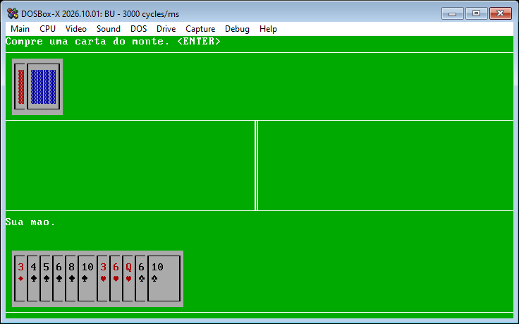
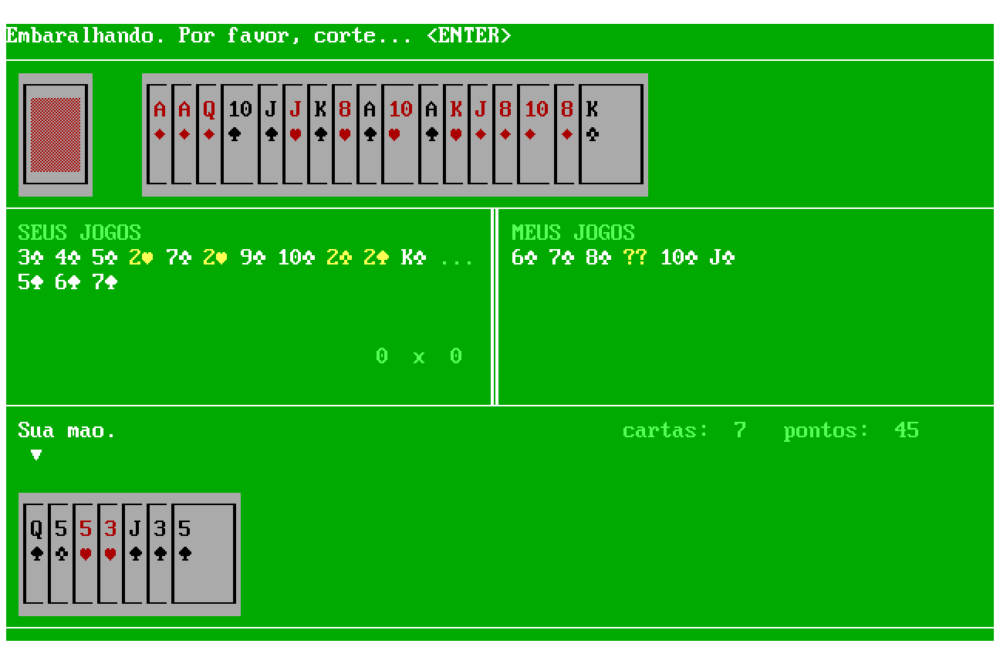
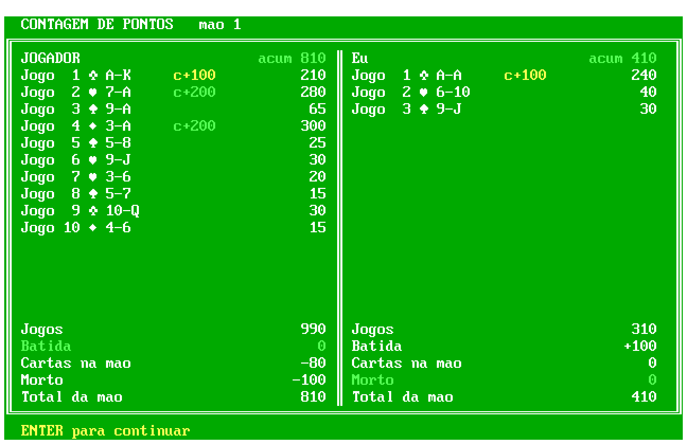

# Buraco — do MS-DOS ao Windows com SDL2

Reengenharia e porte nativo do clássico de cartas **Buraco** (`BURACO.EXE`),
originalmente distribuído para MS-DOS.

O projeto é dividido em duas frentes:

1. **Reengenharia reversa** do executável original — descompactação com
   *UNP 4.11*, análise em *Ghidra* e captura de runs em *DOSBox-X*
   (regiões `work/` e `tools/`);
2. **Porte nativo** — reimplementação do jogo em **C++20 + SDL2**, sem
   emulação: regras, baralho, IA, máquina de turnos e apresentação foram
   reescritos, mantendo a mesma tela de texto 80×25 (glifos CP437 com a
   fonte VGA 8×16 extraída dos glifos do próprio jogo).

> Detalhes técnicos completos (endereços do descompilado, FPS/teclado fake
> BIOS, tabela da fonte, gravação/restauração) estão em
> [`port/README.md`](port/README.md).

## Build

```powershell
# build rápido (MinGW-w64 + CMake + SDL2 no work\toolchain)
.\port\build.ps1

# ou manualmente:
cmake -S port -B port\build -G "MinGW Makefiles" -DCMAKE_BUILD_TYPE=Release `
      -DSDL2_DIR=work\toolchain\sdl2\SDL2-2.32.10\x86_64-w64-mingw32\lib\cmake\SDL2
cmake --build port\build
Copy-Item work\toolchain\sdl2\SDL2-2.32.10\x86_64-w64-mingw32\bin\SDL2.dll port\build\
.\port\build\buraco.exe
```

Os scripts de build detalhados usam *MinGW-w64 GCC 16.2.0 (UCRT, POSIX, SEH)*,
*CMake 4.4.4* e *SDL2 2.32.10* (pacote `SDL2-devel-*-mingw.zip`). Fluxo com
`vcpkg` + gerador Visual Studio também funciona — veja `port/README.md`.

### Controles

| Tecla | Ação |
|---|---|
| ← / → | escolhe a carta sob o cursor |
| ↑ / ↓ | rola a lista de jogos na mesa |
| `Espaço` | marca/desmarca a carta para baixar |
| `ENTER` (compra) | compra do monte (`S`/`N` compra a mesa inteira) |
| `ENTER` (jogo) | baixa as cartas marcadas; sem marcação → descarte |
| `A` / `N` | aumenta o jogo existente ou baixa um novo do mesmo naipe |
| `ENTER` (tela inicial) | continua o save encontrado ou pede o nome do jogador |
| `S` / `N` | continua o jogo gravado (`S`) ou cria um novo (`N`) |
| `F1` / `F3` | ajuda / situação geral em tela cheia |
| `F2` / `F5` | grava (`<nome>.sav`) / restaura partida |
| `ESC` | limpa a seleção; sem seleção, encerra |

## Capturas

| Original (DOSBox-X, 720×400) | Porte (SDL2) |
|---|---|
|  |  |

Baixas e canastras no porte:



Contagem de pontos, jogo por jogo, com bônus e descontos:



## O que já está pronto

* Baralho de 108 cartas (2 baralhos + 4 curingas), distribuição 11/11,
  morto de 22 e monte de 64.
* Comprar do monte ou comprar a mesa (leva **todas** as cartas), baixar e
  aumentar jogos, até 15 jogos por jogador (inclusive do mesmo naipe);
  aumentar um jogo aceita qualquer número de cartas (até uma).
* Curingas preenchendo buracos internos e estendendo o topo.
* Pegar o morto (11 + 11), penalidade de −100 para quem nunca pegou.
* Bater (+100 fixo) com exigência de canastra; canastra limpa +200 / suja
  +100 / real +500, partida até 3.000 pontos com várias mãos.
* Tela de contagem detalhada: cada jogo baixado com seus pontos, soma dos
  jogos, batida, cartas na mão e morto, e o total da mão.
* Tela inicial com o texto de apresentação; depois do `ENTER`, o jogo procura
  um progresso gravado na pasta do jogo e pergunta se o jogador quer continuar
  ou começar um novo. No jogo novo, o nome digitado vira o arquivo de progresso
  (`joao.sav`, `joao2.sav`, ...). `F2` grava e `F3` mostra a situação geral em
  tela cheia.
* Fonte VGA 8×16 autêntica (256 glifos × 16 bytes) extraída de uma run do
  `ALLCHARS.COM` no DOSBox-X.
* Modo *headless* determinístico (`--auto`, `--script`, `--check`,
  `--savetest`, `--flow`) para regressão e *diffs* de tela — ver
  [`port/README.md`](port/README.md) para os comandos completos.
* Validação: `--check 20000` fecha partidas inteiras em 14 seeds sem perder
  ou duplicar cartas; `--savetest 900` garante ida-e-volta fiel do save.

## Estrutura

```
port/            o porte SDL2 (C++20)
  src/main.cpp   plataforma dos::*, apresentação ui::* e main()
  src/cards.*    modelo de carta, validação de jogo, valor de canastra
  src/game.*     máquina de turnos, IA, contagem de pontos, partida
  assets/        font8x16.bin (fonte VGA extraída do executável)
shots/           capturas do original e do porte
tools/           scripts de captura (Python), extração de fonte, run/livre
work/            descompilados, runs de teste, toolchain SDL2, corpos provisórios
```

Destaques de como a integração é feita: o porte reproduz os serviços de BIOS
do original (`INT 10h/16h/33h`, DAC VGA, VRAM B800/A000) por uma camada
`dos::*`, de forma que o código do jogo escreve nos mesmos buffers de texto e
de vídeo virtuais que o `BURACO.EXE` escrevia — a apresentação é uma camada
separada e substituível (`ui::*`) que encaminha para SDL2.

## Notas

* `BURACO.EXE` está neste repositório apenas como material de referência.
  Todos os direitos do jogo original pertencem aos seus donos.
* Run de referência para a régua da fonte: veja `tools/UNPACK.md` e
  `work/ghidra/out/decompiled.c` (funções `FUN_1000_1920`, `FUN_1000_258a`,
  `FUN_1000_30bf`).
* Semente: no modo interativo o jogo sorteia uma semente nova por partida;
  nos modos de teste ela é fixada (`--seed N`) para ser reproduzível.

## Roadmap sugerido

- [ ] Som
- [ ] Modo multi-jogador (rede/hot-seat)
- [ ] Tradução da interface
- [ ] Opções de janela/redimensionamento
